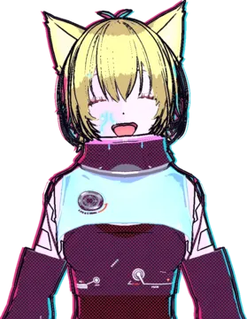
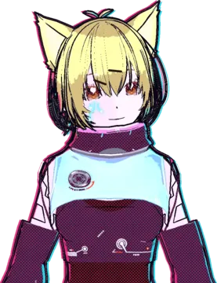
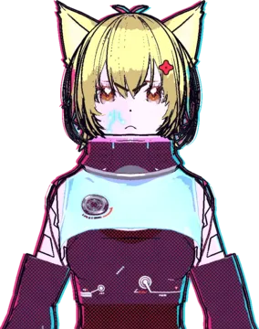
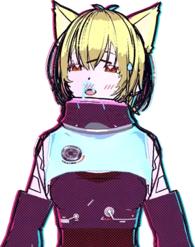
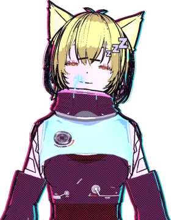
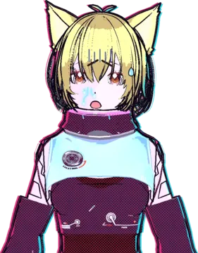

<div align="center">


<br>




## `// ABOUT_ME`

</div>

```yaml
name:    Leonardo Goemann Santana
alias:   leogoemann
pronoun: he/him
loves:   [games, music, animals]
hobbies: [technology, web development, automation]
status:  studying Software Engineering
```

> I've been diving into the world of IT since **2020**. I'm all about exploring new ways to learn
> and getting acquainted with fresh programming languages.

<div align="center">


## `// SKILL_MATRIX`

<sub><code>LANGUAGES</code></sub><br>


<br>
<sub><code>WEB &amp; FRAMEWORKS</code></sub><br>


<br>
<sub><code>DATA, AI &amp; IOT</code></sub><br>


<br>
<sub><code>TOOLS &amp; SYSTEM</code></sub><br>


<br>

<br><br>

<sub>I did technical high school from 2020 to 2022 in the IT field.<br>
Those years made me fall even more in love with technology.<br>
Since then, I've been honing my skills in various programming languages.</sub>


## `// CURRENT_PROJECT`

</div>

```text
> PANDORA   desktop AI companion, 100% local (Tauri + Ollama)
> STATUS    in development
```

<div align="center">


## `// POKE_PANDORA`

<sub>she reacts to what you do. click a mood.</sub>

<br>

<table align="center"><tr>
<td align="center" valign="top">

<details>
<summary><b>HAPPY</b></summary>
<br>
<br>
<sub><i>"Don't get used to it. I'm only smiling because your code compiled."</i></sub>
</details>

</td>
<td align="center" valign="top">

<details>
<summary><b>SMUG</b></summary>
<br>
<br>
<sub><i>"Yeah, I know I'm good. You don't have to look that impressed."</i></sub>
</details>

</td>
<td align="center" valign="top">

<details>
<summary><b>ANGRY</b></summary>
<br>
<br>
<sub><i>"Say that again. I dare you."</i></sub>
</details>

</td>
</tr><tr>
<td align="center" valign="top">

<details>
<summary><b>EMBARRASSED</b></summary>
<br>
<br>
<sub><i>"I-it's not like I care what you think! Stop staring!"</i></sub>
</details>

</td>
<td align="center" valign="top">

<details>
<summary><b>SLEEPY</b></summary>
<br>
<br>
<sub><i>"It's 3 a.m. and you're still coding? ...Fine. I'll stay up too."</i></sub>
</details>

</td>
<td align="center" valign="top">

<details>
<summary><b>SCARED</b></summary>
<br>
<br>
<sub><i>"Did you just run rm -rf on something?! Tell me you didn't."</i></sub>
</details>

</td>
</tr></table>

<br>


## `// ASK_PANDORA`

<sub>click a question.</sub>

</div>

<details>
<summary><b>&gt; what is Pandora?</b></summary>

> A transparent always-on-top desktop companion. A 2D/3D girl who talks (text and voice), remembers things in an Obsidian vault, reacts to what I'm doing on the PC and runs a few actions (search, open sites, Spotify, media). *"A 'companion'? Say assistant one more time."*
</details>

<details>
<summary><b>&gt; is it cloud AI?</b></summary>

> Mostly local: the brain is Ollama (`qwen3:4b` for chat/memory, `gemma3:4b` for vision). Optionally a hosted model on a faster fallback chain: hosted → remote Ollama over Tailscale → local.
</details>

<details>
<summary><b>&gt; what's her stack?</b></summary>

> Tauri 2 + Vite (vanilla JS), Rust on the backend, a Python voice server (Whisper, TTS), sprites baked from a VRM model. Runs on Arch + Hyprland and on Windows.
</details>

<details>
<summary><b>&gt; can she walk around my screen?</b></summary>

> Yes. In "free mode" she walks on top of your windows, sits on their edges, falls when the window closes and waves goodbye when you lock the PC.
</details>

<div align="center">


## `// OPEN_CHANNELS`

<a href="https://www.instagram.com/leogoemann/"></a>

<br><br>


</div>
