

<a href="#"></a>

<a href="#"></a>

<a href="#">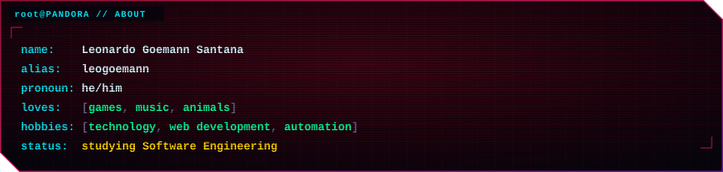</a>

<a href="#">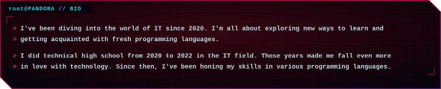</a>

<a href="#"></a>

<a href="#">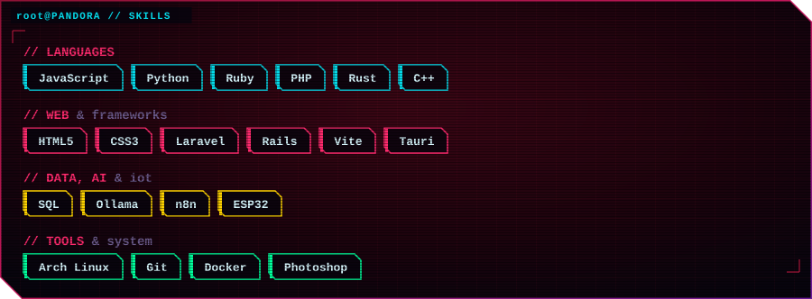</a>

<a href="#"></a>

<a href="#">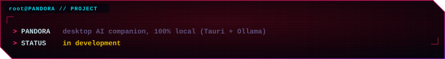</a>

<a href="#"></a>

<a href="#"></a>

<a href="#"></a>

<a href="#">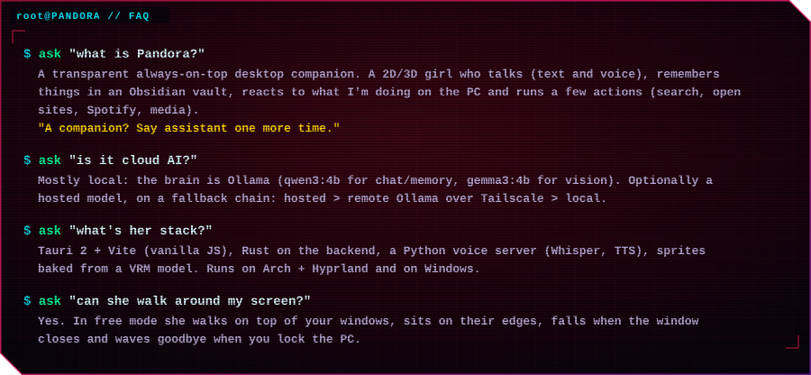</a>

<a href="#"></a>

&nbsp;&nbsp;

<a href="#">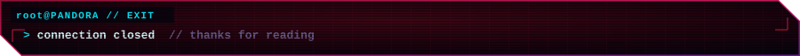</a>

